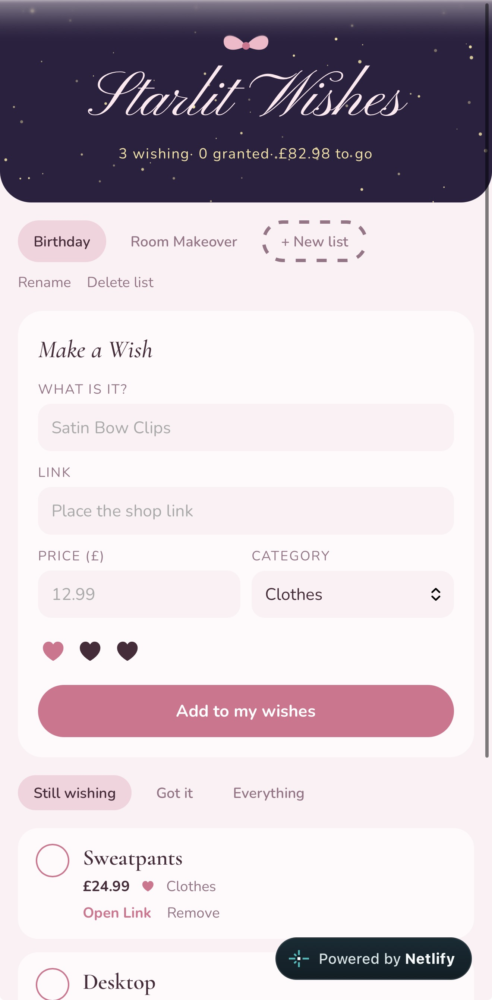
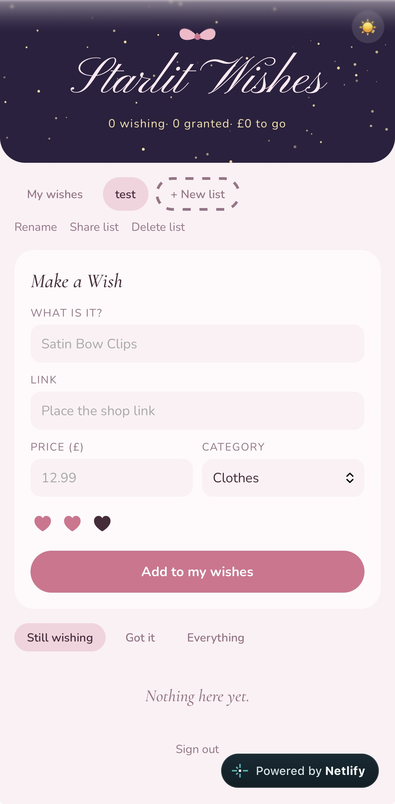
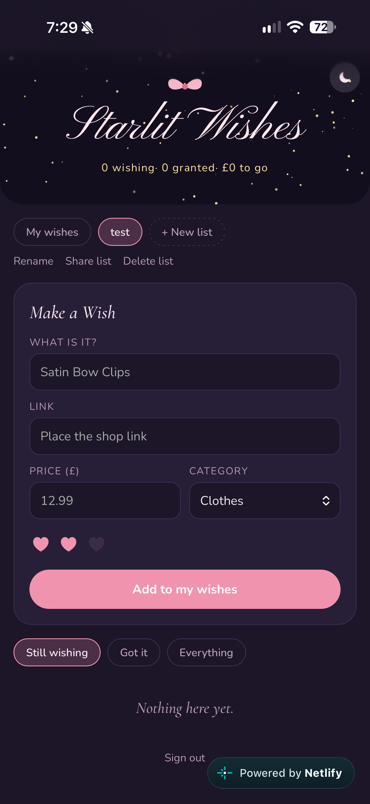

# Starlit Wishes ✦
A coquette, starry wish list app! Keep separate lists for birthdays, Christmas or a room makeover, share them with family as gift lists, and install it on your phone like a real app.

**[Try it live → starlit-wishes.netlify.app](https://starlit-wishes.netlify.app)**

<p>
  
  
  
</p>


### Features ⋆.𐙚 ̊
---
- Separate lists
    - Create, rename and delete lists
    - Move wishes between lists
- Wishes with a shop link, price, category and a 1–3 heart rating
- Product photos that appear automatically from a pasted shop link
- Tick off what you get, with filters and a running total of what's left
- Share a list with family as a read-only gift list (no account needed to view)
- Sign in with email and password, so your lists sync across devices
- Light and dark mode, with a toggle
- Installable on your phone's home screen


### Tech Stack ⋆.𐙚 ̊
---
- Javascript
    - React
    - Vite
- CSS
    - CSS variables
- Supabase
    - Postgres
    - Auth
    - Row-level security
- Netlify
    - Hosting
    - Netlify Functions
- PWA (vite-plugin-pwa)
- GitHub Issues & Projects


### How It Works ⋆.𐙚 ̊
---
- **Data:** two tables, `lists` and `wishes`, linked by `list_id`. Deleting a list deletes its wishes too.
- **Security:** row-level security means each person can only see and change their own lists. The database enforces it, not just the app.
- **Gift lists:** a shared list gets a long random code. Visitors use a small SQL function that returns that one list and nothing else, so nobody can browse other people's lists.
- **Product photos:** browsers can't read other websites directly, so a Netlify Function fetches the shop page and finds its product image. If a shop blocks it, the wish still saves without a picture.


### Run It Locally ⋆.𐙚 ̊
---
You'll need Node.js 20+ and a free [Supabase](https://supabase.com) project.

```bash
git clone https://github.com/Ashley-keen/starlit-wishes.git
cd starlit-wishes
npm install
```

1. In Supabase's SQL Editor, run [`supabase/schema.sql`](supabase/schema.sql)
2. Create a `.env.local` file:

   ```
   VITE_SUPABASE_URL=https://your-project.supabase.co
   VITE_SUPABASE_ANON_KEY=your-publishable-key
   ```

3. Start the app and functions together with `npx netlify dev`
4. Open [http://localhost:8888](http://localhost:8888)


### How I Built It ⋆.𐙚 ̊
---
I planned the app as 22 GitHub issues on a project board, split into three milestones. Each issue was built on its own branch and merged with a pull request.

- **v1, works on my phone:** UI, lists, saving in the browser, installable, deployed to Netlify
- **v2, synced to the cloud:** Supabase database, login, row-level security
- **v3, extras:** password login, moving wishes, dark mode, gift list sharing, product photos


### What I Learned ⋆.𐙚 ̊
---
- **Planning like a team:** small issues with clear checklists made a big project feel manageable
- **Modelling related data:** linking wishes to lists by id made moving and deleting simple, first in the browser and then in Postgres
- **Security belongs in the database:** row-level security protects everyone's data even if the front end has a bug
- **Immutable React state:** creating new arrays with `map`, `filter` and spread so React knows to re-render
- **Working around browser limits:** the photo lookup runs in a serverless function because of CORS
- **Naming matters:** lowercase file names worked on my Mac but would have broken on Netlify's servers


### Ideas For Next Time ⋆.𐙚 ̊
---
- Let family mark gift-list items as "reserved" without the owner seeing who
- A "find picture" button for older wishes
- Price-drop reminders

---
Made by [Ashley Keen](https://github.com/Ashley-keen) ✦

### License ⋆.𐙚 ̊
---
This project is licensed under the [MIT License](LICENSE).
